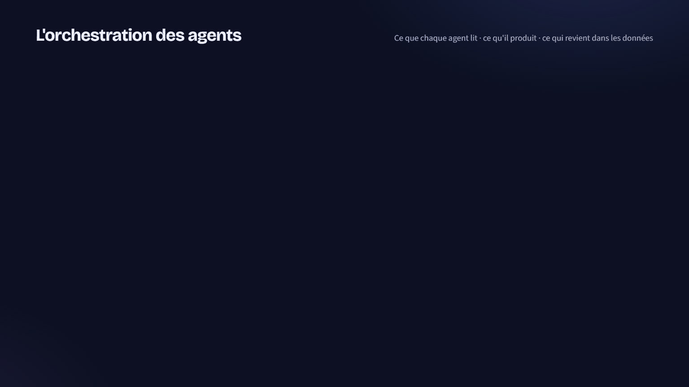

# DeliveryOps — Agentic AI for AMS/TMA delivery

Multi-agent platform that assists application-maintenance teams across the whole lifecycle of a
perimeter: onboarding, client meetings, pre-billing, capacity planning, service governance and
steering committees. Every impactful recommendation goes through a traced human decision.

<p align="center">
  
</p>

> 🎬 Full end-to-end demo (contract takeover for a new client): [`demo-video/DeliveryOps-demo-presentation.mp4`](demo-video/DeliveryOps-demo-presentation.mp4)

> 📚 **Full documentation:** see [`docs/`](docs/README.md) — architecture, backend, frontend, desktop,
> data model, setup, security, and per‑feature guides (companion, automations, livrables, team, agents,
> knowledge, call assistant, Microsoft).

## Architecture

```
Angular 21 ──HTTP──► FastAPI ──► Orchestrator (LangGraph supervisor, checkpointed)
     │                  │           plan → supervisor ⇄ agents → approval gate (interrupt) → finalize
     │                  │
     │                  ├─► Copilot agent (tool use over 11 platform tools, can propose actions)
     │                  ├─► Proactive watch (scheduled connector sync + deterministic checks → notifications, Teams)
     │                  ├─► Exports (COPIL PPTX, pre-invoice XLSX + justificatifs, minutes & onboarding DOCX)
     │                  └─► Telemetry (tokens, cost, latency per agent) + recommendation acceptance
     │
     └─ Keycloak (OIDC/PKCE, user admin)   MCP server ──► same tools for any MCP-compatible assistant

 Agents: Knowledge Transfer · Meeting Intelligence · Billing · Capacity Planning · Delivery Governance
         Incident & Problem · Estimation · Copilot
 Data:   PostgreSQL + pgvector (business data, vectors, LangGraph checkpoints, audit, telemetry)
 Inputs: documents (PDF/DOCX/XLSX/MD), CSV/Excel imports, Jira / ServiceNow connectors, Teams transcripts
```

**Design rule:** numbers shown to a client (amounts, SLA %, loads) are computed by deterministic
code in `backend/app/analytics/`. The LLM extracts, reasons and writes (risks, knowledge cards,
minutes, COPIL narrative, contract-rule extraction, copilot answers), always with a fallback so the
platform runs end-to-end offline.

**LLM provider:** any OpenAI-compatible chat-completions API — `backend/app/llm.py` talks to it
through the `openai` SDK pointed at `LLM_BASE_URL`. Defaults to NVIDIA's hosted API catalog
(`integrate.api.nvidia.com`, OpenAI-compatible, has a free tier), but works unchanged against vLLM,
Ollama, Azure OpenAI, or a company gateway — just change `LLM_BASE_URL` / `LLM_API_KEY` / the model
names. JSON output uses NIM's `guided_json` (`nvext`) by default; switch `LLM_JSON_MODE` to
`json_schema` or `json_object` for endpoints that use standard OpenAI `response_format` instead, or
`prompt` for one with neither. `LLM_TOOL_MODE=json` switches the Copilot from native OpenAI tool
calling to a JSON action protocol for models that don't support tool calling at all.

| Capability | Where |
|---|---|
| Orchestration, dependency ordering, HITL interrupt/resume | `backend/app/agents/orchestrator.py`, `backend/app/runner.py` |
| Agents | `backend/app/agents/*.py` |
| Copilot (native tool calling + JSON-protocol fallback, offline planner) | `backend/app/agents/copilot.py` |
| LLM client (OpenAI-compatible, JSON validation + repair, concurrency limit) | `backend/app/llm.py` |
| AI telemetry & quality dashboard | `backend/app/telemetry.py`, `backend/app/routes/observability.py` |
| RAG (parsing, chunking, hybrid search, citations) | `backend/app/knowledge.py` |
| Onboarding imports & readiness checklist | `backend/app/importer.py`, `backend/app/routes/onboarding.py` |
| Jira / ServiceNow / demo connectors | `backend/app/connectors.py` |
| Proactive watch & notifications | `backend/app/watch.py`, `backend/app/notify.py` |
| Office exports | `backend/app/exports.py` |
| Teams transcript parsing | `backend/app/transcripts.py` |
| MCP server | `backend/app/mcp_server.py` |
| Auth: Keycloak JWT validation, client isolation | `backend/app/auth.py`, `frontend/src/app/auth.ts` |
| In-app user administration (Keycloak Admin API) | `backend/app/keycloak_admin.py`, `backend/app/routes/users.py`, `frontend/src/app/pages/admin-users.ts` |
| Production middleware: rate limiting, security headers, request logging | `backend/app/middleware.py` |
| Database migrations | `backend/alembic/` |
| Microsoft Entra ID SSO + Graph | `backend/app/microsoft_graph.py`, `backend/app/routes/microsoft.py`, `frontend/src/app/microsoft-auth.ts`, `frontend/src/app/pages/microsoft.ts` |
| Desktop shell (local files, call assistant) | `desktop/`, `frontend/src/app/desktop.ts`, `frontend/src/app/pages/local-files.ts`, `frontend/src/app/pages/call-assistant.ts` |

## Features

**Agents and workflows**
- *Onboarding*: document analysis, dependency map with single points of failure, sourced risks, knowledge concentration, **application knowledge cards**, 4-week plan and executive summary. Approved cards are indexed into the knowledge base.
- *Meetings*: live assistant (browser mic or typing) answering with sources and flagging out-of-scope requests; **Teams transcript import** (.vtt/.docx); minutes with actions, decisions, risks.
- *Billing*: pre-invoice from contract rules (fixed fee, time & material with cap, work units, SLA penalties) and anomaly report (double billing, unjustified régie, missing timesheets, out-of-scope work absorbed…).
- *Capacity*: 8-week forecast with absences, what-if scenarios, staffing proposals, skills held by one person.
- *Governance*: scorecard vs contract, drifts and trends, COPIL pack and action plan.
- *Incident & Problem*: recurring clusters → problem tickets on approval, duplicates, known resolutions.
- *Estimation*: P50/P80 from actual hours of similar changes, work-unit mapping.
- *Copilot*: conversational agent that picks its tools, cites sources, can file an action or start a workflow (both human-validated).

**Corporate foundations**
- Human-in-the-loop: deliverables block the workflow until decided; rejections require a reason; approved items apply their effect (assignments, problem tickets, contract rules, knowledge).
- Traceability: sources and confidence on every recommendation, full audit log.
- **Real auth**: Keycloak OIDC/PKCE login, RS256 JWT validated server-side (signature, issuer, audience, expiry — see `tests/test_auth.py`), roles and client access derived from token claims. Client isolation by role and client assignment.
- **In-app user administration**: directors can invite, role-assign, disable and reset passwords for users directly from DeliveryOps, via the Keycloak Admin API (optional — falls back to managing users in the Keycloak console).
- Proactive watch: SLA breaches and near-breaches, KPI drift, incident spikes, 2-week overload, régie run-rate vs cap, missing timesheets, open out-of-scope work, stale approvals. Deduplicated in-app notifications, Teams cards for critical ones.
- Onboarding wizard: create client/perimeter, CSV/Excel imports with row-level validation, readiness score.
- Connectors: Jira Cloud, ServiceNow, demo feed; secrets only via environment variable names, never stored.
- Exports: COPIL deck (PPTX), pre-invoice workbook with supporting timesheets (XLSX), minutes and onboarding pack (DOCX).
- AI observability: calls, tokens, cache hit rate, latency and cost per agent; recommendation acceptance rate and rejection reasons.
- MCP server so external assistants use the same tools and access rules.
- **Production-ready**: Alembic migrations (schema drift check at boot), rate limiting, security headers, structured JSON logs with request IDs, non-root multi-stage Docker images, health checks, `ENVIRONMENT=production` config guard that refuses to start misconfigured (dev auth, SQLite, demo seed data, wildcard CORS).

## Ports (local dev / demo)

DeliveryOps is independent from other local projects (own repo, compose project `deliveryops`, `deliveryops-*` containers, network and volume). Frontend **4300**, API **8100**, Keycloak **8280**, Postgres **5433**, MCP **8765**.

## Run locally (no Docker)

```bash
# backend
cd backend
python -m venv .venv && .venv/Scripts/pip install -r requirements.txt   # Linux/macOS: .venv/bin/pip
.venv/Scripts/python -m app.seed.seed
.venv/Scripts/python -m uvicorn app.main:app --port 8100

# frontend (another terminal) — Node 24.x
cd frontend && npm install && npm start      # http://localhost:4300 (proxies /api to :8100)
```

SQLite and the persona switcher (bottom-left) are used by default (`AUTH_MODE=dev`). Set
`LLM_API_KEY` in `.env` to enable the LLM (see the provider note above); without it every agent
runs on its deterministic fallback (badge "Mode hors ligne").

Tests: `cd backend && .venv/Scripts/python -m pytest -q` (40 tests: agents, billing rules engine,
auth JWT validation against a real self-signed keypair, rate limiter, production config guard,
Keycloak Admin API against a live throwaway container — see `tests/test_keycloak_admin.py`).

## Run with Docker (local dev / demo)

```bash
cp .env.example .env   # optionally add LLM_API_KEY
docker compose up -d --build
docker compose --profile mcp up -d mcp     # optional MCP endpoint on :8765
```

Keycloak admin: admin/admin. Demo users sarah (director), karim and lea (delivery managers), tom
(consultant), password `demo`. Dev auth mode is used by default; set `AUTH_MODE=keycloak` in `.env`
to exercise real SSO locally against the bundled dev realm.

## Production deployment

Single server, Docker Compose, Caddy for automatic HTTPS. Nothing but Caddy (80/443) is published
to the host — Postgres, Keycloak and the backend are reachable only on the internal Docker network.

**1. DNS** — point two records at the server: `DOMAIN` (the app) and `AUTH_DOMAIN` (Keycloak). Both
must resolve before starting Caddy, or Let's Encrypt issuance fails.

**2. Configure secrets**
```bash
cp .env.prod.example .env.prod
# edit .env.prod: DOMAIN, AUTH_DOMAIN, ACME_EMAIL, POSTGRES_PASSWORD, KEYCLOAK_ADMIN_PASSWORD,
# LLM_API_KEY (or leave empty to run offline)
```

**3. Point the Keycloak realm at your domain** — `infra/keycloak/realm-deliveryops.prod.json`
ships with `redirectUris`/`webOrigins` set to `https://CHANGE_ME.example.com`; replace that with
your real `DOMAIN` before first boot. This template has **no demo users or passwords** — unlike the
dev realm, it only defines the roles and the two OAuth clients.

**4. First boot**
```bash
docker compose -f docker-compose.prod.yml --env-file .env.prod up -d --build
```
This applies database migrations automatically (the `backend` container's entrypoint runs
`alembic upgrade head` before starting when `ENVIRONMENT=production`) and imports the realm.

**5. Wire up the in-app user admin (optional)** — Keycloak Admin Console → Clients →
`deliveryops-admin` → Credentials tab → copy the client secret → set
`KEYCLOAK_ADMIN_CLIENT_SECRET` in `.env.prod` → `docker compose -f docker-compose.prod.yml
--env-file .env.prod up -d backend`. The service account already has the right
`realm-management` roles (`manage-users`, `view-users`, `query-users`) from the realm import.
Without this step, manage users directly in the Keycloak console instead.

**6. Create the first real user** — Keycloak Admin Console → Users → Add user, set the `director`
realm role and no `clients` attribute (directors see every client). From then on, that director can
invite the rest of the team from DeliveryOps's own Users page.

**Scaling**: add more `backend` replicas behind Caddy for more API throughput. The rate limiter and
connector-sync scheduling are process-local, so know the tradeoffs first — see the docstring at the
top of `backend/app/middleware.py`. The proactive-watch scheduler always runs in its own
single-replica `backend-worker` container regardless of how many `backend` (API) replicas you run,
so it's never duplicated.

**Updating**: `git pull && docker compose -f docker-compose.prod.yml --env-file .env.prod up -d
--build` — the entrypoint re-applies any new migrations automatically.

## Desktop app (local PC files + call assistant)

`desktop/` is an Electron shell over the web app that adds what a browser can't: reading your PC's
local files, and a floating window that assists a live Teams call. Start the stack, then:

```bash
cd desktop && npm install && npm start    # loads http://localhost:4300 by default
```

- **Fichiers PC** (sidebar, desktop only): browse your Desktop/Documents/Downloads (add more folders
  with the picker), preview text files, and push documents into a perimeter's knowledge base — the
  same extraction pipeline as an upload. Read-only, path-traversal-guarded (`desktop/src/local-files.js`).
- **Assistant d'appel**: opens an always-on-top window that suggests sourced answers during a call
  (see below). Details in `desktop/README.md`.

## Microsoft Entra ID (SSO + Graph)

When `MICROSOFT_TENANT_ID` / `MICROSOFT_CLIENT_ID` are set, DeliveryOps can sign users in with the
Microsoft account on the PC and read their Microsoft 365 data (Outlook, Teams, OneDrive/SharePoint,
To Do) via Microsoft Graph — shown on the **Mon espace Microsoft** page. With `AUTH_MODE=microsoft`
it becomes the sign-in front door: on open, the app tries `ssoSilent` (zero prompt on Entra-joined
PCs with Edge/Chrome; otherwise one consent click). The SPA (MSAL) holds the Graph token and the
backend relays it to Graph — **no client secret** needed.

**One-time app registration** (only you can do this, ~5 min — it's in your tenant):

1. Azure Portal → **Microsoft Entra ID** → **App registrations** → **New registration**.
   Name it `DeliveryOps`. Supported account types: your org (single tenant) is fine.
   Redirect URI → platform **Single-page application (SPA)** → `http://localhost:4300`
   (add your production `https://…` origin too when you deploy).
2. Copy the **Application (client) ID** and **Directory (tenant) ID** from the Overview page into
   `MICROSOFT_CLIENT_ID` / `MICROSOFT_TENANT_ID` in `.env`, then restart the backend.
3. **API permissions** → Add → Microsoft Graph → **Delegated** → add: `User.Read`, `Mail.Read`,
   `Calendars.Read`, `Files.Read.All`, `Sites.Read.All`, `Tasks.Read`, `Chat.Read`,
   `Team.ReadBasic.All`, `Presence.Read`. Users consent on first sign-in; some scopes
   (Files/Sites/Chat) may need a tenant admin to click **Grant admin consent**.

Each source degrades on its own — if a scope isn't consented or your account doesn't expose it, that
tile shows why and the rest still load. Every Microsoft-signed-in user is a director for now (sees
all perimeters); map Entra groups to roles in `backend/app/auth.py` when you need finer access.

## Live call assistant

**Assistant d'appel** (sidebar, or a floating window in the desktop app) suggests sourced answers
during a client call, from the same Meeting Intelligence agent as the in-app meeting assistant.
Pick a perimeter → *Démarrer* → it transcribes your microphone live (browser speech recognition,
fr-FR) and auto-answers detected questions, plus a box to paste what the client just asked. Ending
the call generates the minutes. Capturing the *other* party's audio automatically needs a virtual
audio cable into your mic, or server-side speech-to-text (Azure Speech / Whisper) — on the roadmap.

## MCP

```bash
cd backend && DELIVERYOPS_USER=karim .venv/Scripts/python -m app.mcp_server           # stdio
cd backend && .venv/Scripts/python -m app.mcp_server --http 8765                       # streamable HTTP
```

Tools: `list_perimeters`, `search_documents`, `get_service_kpis`, `list_tickets`, `find_similar_incidents`, `get_application_map`, `get_capacity_forecast`, `get_prebilling`, `estimate_change_request`, `propose_action`.

## Demo script (≈15 min)

1. **Portfolio** as Sarah (director): two clients; the bell shows proactive alerts (KPI drift, overload, out-of-scope work).
2. **+ Nouveau périmètre**: create a perimeter, import CSV templates in *Paramétrage*, watch the readiness score; add a *Flux de démonstration* connector and sync.
3. **SI Sinistres → Connaissance**: dependency map, search "reprise IND060", run *Onboarding* → sourced risks, knowledge cards, 4-week plan; download the Word pack.
4. **Copilot**: "L'équipe peut-elle absorber +20 % d'incidents ?" — tool trace, sources; ask it to file an action → appears in *Validations*.
5. **Réunions**: live demo scenario (answers + out-of-scope flag), or import a Teams .vtt → minutes to validate.
6. **Facturation**: anomalies, export the Excel workbook with justificatifs.
7. **Capacité**: +20 % incidents / +1 FTE / remove Mehdi.
8. **Pilotage → Préparer le COPIL**: orchestration, approval gate, approve/reject with reason → workflow completes; download the PPTX deck.
9. Switch to **Tom** (cannot validate) and **Léa** (Banque Horizon only).
10. **Utilisateurs** (director only, needs Keycloak admin API configured), **Observabilité IA**, **Journal d'audit**.

## Known limits / next steps
- Streaming of copilot and workflow progress (SSE) instead of polling.
- Teams live audio via a Graph media bot (browser speech recognition and transcript import today).
- Multi-replica rate limiting needs a shared store (Redis) — currently in-memory per `backend` container.
- Langfuse/OpenTelemetry export of the telemetry; evaluation datasets built from rejected recommendations.
- Neo4j if dependency graphs outgrow networkx; object storage for original uploaded files.
